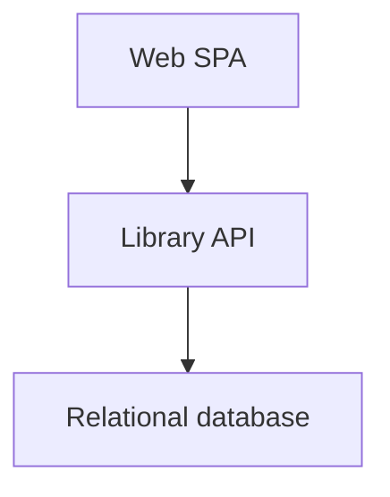
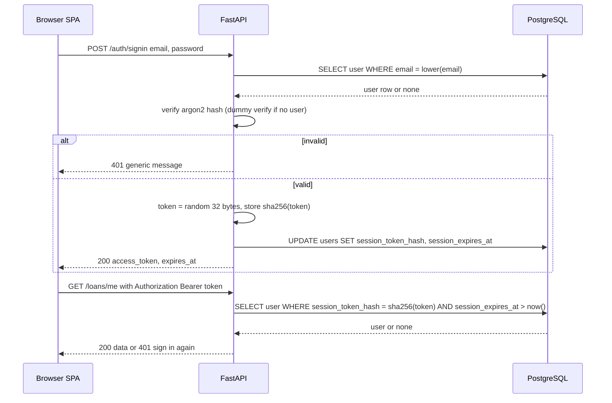
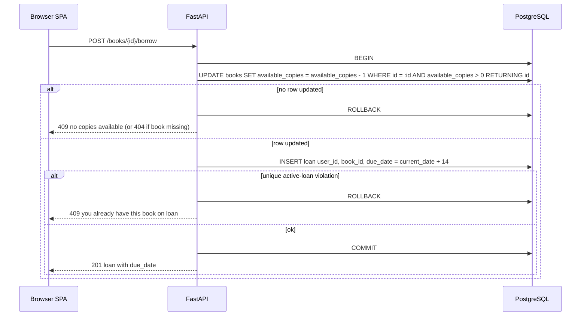
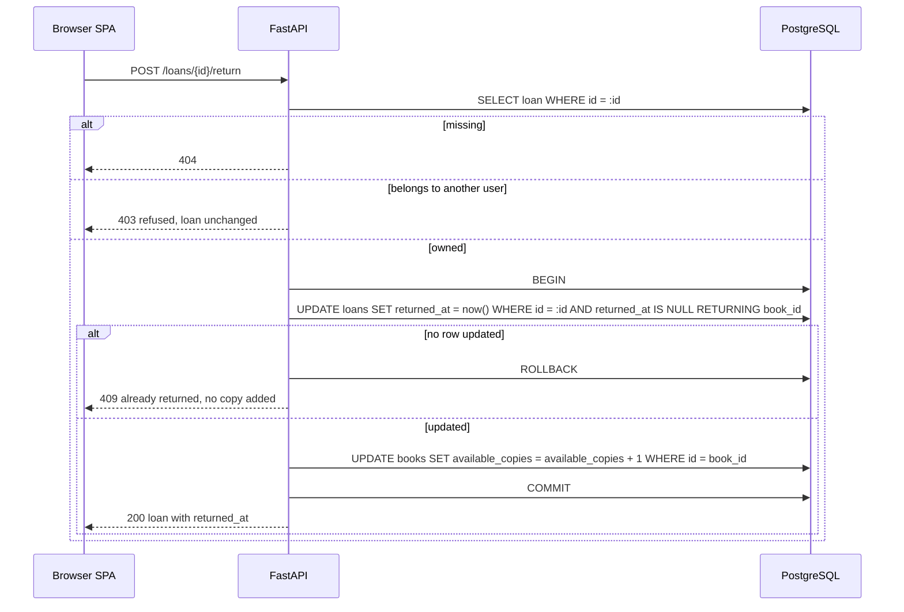
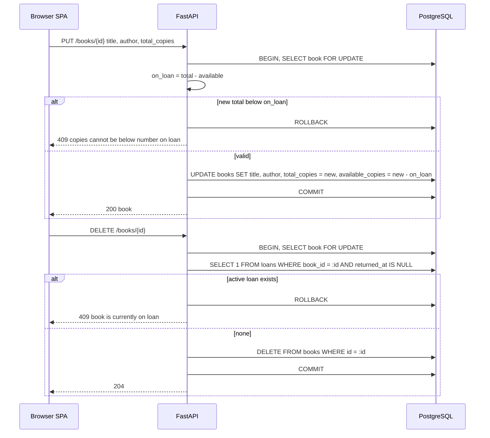
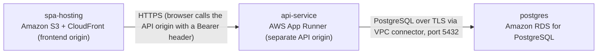

# Architecture

> Maintained by QuorQ AI SDLC. Text between `sdlc:auto` markers is regenerated; anything outside them is yours and is kept.

<!-- sdlc:auto:start narrative -->
## Overview

### ARCH-OVERVIEW · approved · source: architecture:v1

Small three-tier web app on the approved stack. The React SPA calls a FastAPI REST API on a separate origin, which uses PostgreSQL on AWS RDS. No external services, API keys, caches or queues are needed.

- Version: 1; status: approved.
- SPA: React 19, served from its own host (S3 + CloudFront).
- API: FastAPI 0.115, on a separate origin, with CORS applied for the SPA origin.
- Database: PostgreSQL 16 on AWS RDS.
- Auth: server-side sessions with an opaque bearer token. The token's hash and expiry are stored on the users row, so the schema stays at exactly three tables: users, books, loans.
- Business rules are enforced in the API inside single database transactions:
  - borrow only if a copy is available
  - no duplicate active loan
  - due date 14 days out
  - only the borrower can return
  - no deleting a book that is on loan
  - copies never below the number on loan
- Copy-count correctness under concurrency: row locks or atomic conditional updates, plus database CHECK and partial unique constraints.
- Overdue status is derived at read time and never stored.
- Search uses case-insensitive ILIKE, which is enough for thousands of books.

**Related:** ARCH-COMP-SPA, ARCH-COMP-API, ARCH-COMP-DB, ARCH-DATA, ARCH-API

### ARCH-COMP-SPA · approved · source: architecture:v1:component:spa

Web SPA (React 19). It is the client-rendered front end for sign-up/sign-in, book management, search and the loan dashboard.

- Screens:
  - sign-up and sign-in
  - book list with search and browse-available
  - add and edit book form with delete confirmation
  - dashboard of the user's current and overdue loans, with borrow and return buttons
- Stores the session token and sends it as a Bearer header.
- Redirects to sign-in when there is no token or the API returns 401.
- Shows the API's clear validation and refusal messages.

**Related:** ARCH-COMP-API, ARCH-DEPLOY-SPA

### ARCH-COMP-API · approved · source: architecture:v1:component:api

Library API (FastAPI 0.115). REST API holding all authentication, business rules and queries.

- Sign-up with hashed passwords.
- Sign-in and sign-out with opaque server-side session tokens.
- Bearer-token authentication on every protected route.
- Book CRUD with the on-loan rules.
- Case-insensitive search and available-only browse.
- Borrow and return with transactional copy accounting.
- Per-user dashboard query, with overdue derived at read time.
- CORS applied for the SPA origin.

**Related:** ARCH-COMP-SPA, ARCH-COMP-DB, ARCH-API, ARCH-DEPLOY-API

### ARCH-COMP-DB · approved · source: architecture:v1:component:db

Relational database (PostgreSQL 16). It stores exactly three tables and enforces integrity itself.

- Tables: users, books, loans.
- Unique lowercase email.
- CHECK constraints on copy counts.
- Foreign keys.
- Partial unique index allowing one active loan per user and book.
- Row-level locking keeps copy counts correct under concurrent borrowing.

**Related:** ARCH-COMP-API, ARCH-DATA, ARCH-DEPLOY-DB

### ARCH-DATA · approved · source: architecture:v1:entities

Data model of three entities: users, books and loans. Session data lives on the users row.

- users: id, email, password_hash, session_token_hash, session_expires_at, created_at
- books: id, title, author, total_copies, available_copies, created_at, updated_at
- loans: id, user_id, book_id, borrowed_at, due_date, returned_at
- Overdue status is not stored. It is computed at read time from due_date.
- Deleting a book removes its returned-loan history by cascade.

**Related:** ARCH-COMP-DB, ARCH-PATH-BORROW, ARCH-PATH-EDITDELETE

### ARCH-API · approved · source: architecture:v1:endpoints

REST endpoints for authentication, books, borrowing/returning, the dashboard and health.

- POST /auth/signup: create an account. Email is lowercased and must be valid and unique; password must be non-empty.
- POST /auth/signin: verify credentials and start a server-side session. The opaque token is returned in the body only.
- POST /auth/signout: revoke the current session by clearing the stored token hash.
- GET /books: list books. `q` does a case-insensitive partial match on title or author. `available_only=true` returns only books with available_copies > 0.
- POST /books: add a book. All copies start available.
- GET /books/{book_id}: get one book, used to prefill the edit form.
- PUT /books/{book_id}: edit title, author and total copies. Rejected if total is below the number currently on loan. available_copies is adjusted by the same delta.
- DELETE /books/{book_id}: delete a book that has no active loans.
- POST /books/{book_id}/borrow: creates a loan due 14 days from today and decrements available copies atomically.
- POST /loans/{loan_id}/return: mark the caller's own loan returned and restore the copy exactly once.
- GET /loans/me: dashboard data for the signed-in user only. `current` lists all unreturned loans, each with an is_overdue flag (due_date < today, computed at read time). `overdue` is the subset of current where is_overdue is true.
- GET /health: liveness check for the hosting platform.

**Related:** ARCH-COMP-API, ARCH-DATA

### ARCH-PATH-AUTH · approved · source: architecture:v1:critical_path:auth

Sign-up and sign-in with a server-side session token. Only the token's hash is stored.

- Sign-up: lowercases and validates the email, hashes the password and inserts the user. A duplicate email is rejected through the unique constraint.
- Sign-in: verifies the hash, generates a random opaque token, and stores only its SHA-256 hash and an expiry on the user row. The plain token is returned once in the response body.
- Protected requests: the API hashes the presented bearer token and looks it up with an unexpired session.
- Sign-out: clears the stored hash.
- A failed sign-in returns the same generic 401 for an unknown email or a wrong password. A dummy hash verification runs for unknown emails to keep timing similar.

**Related:** ARCH-COMP-API, ARCH-DATA

### ARCH-PATH-BORROW · approved · source: architecture:v1:critical_path:borrow

Concurrency-safe borrow in one transaction. A conditional decrement and the loan insert succeed or fail together.

- In one transaction, the API performs a decrement that only succeeds when a copy is available, then inserts the loan with due_date = current date + 14 days.
- The partial unique index on active loans per user and book rejects a duplicate.
- If either step fails, the transaction rolls back and nothing changes.
- With two simultaneous borrows of the last copy, only one decrement matches, so available_copies never goes below zero (backed by a CHECK constraint).

**Related:** ARCH-DATA, ARCH-API, ARCH-PATH-RETURN

### ARCH-PATH-RETURN · approved · source: architecture:v1:critical_path:return

Idempotent, borrower-only return. A second return does not add the copy twice.

- The API first checks that the loan exists and belongs to the caller (403 otherwise).
- In one transaction it marks the loan returned only if returned_at is still null, then increments the book's available copies.
- A second return matches no row, so the copy is not added twice.

**Related:** ARCH-DATA, ARCH-API, ARCH-PATH-BORROW

### ARCH-PATH-EDITDELETE · approved · source: architecture:v1:critical_path:edit_delete

Edit and delete lock the book row so they serialise with borrow and return. Both enforce the on-loan rules.

- Edit and delete lock the book row with SELECT FOR UPDATE.
- Edit computes on_loan = total_copies - available_copies and rejects a new total below on_loan.
- Edit sets available_copies = new_total - on_loan, so an increase raises availability by the same amount.
- Delete is refused if any unreturned loan exists.
- Otherwise the book is removed and its returned-loan history is removed with it by cascade.

**Related:** ARCH-DATA, ARCH-PATH-BORROW, ARCH-PATH-RETURN

### ARCH-TECH-FRONTEND · approved · source: architecture:v1:technology_decision:frontend

Frontend: React 19 (approved stack). Alternatives considered: Next.js, Vue.

- Rationale: a handful of screens with instant search and borrow/return buttons that update counts on screen suit a client-rendered SPA.
- Hosted as static files on S3 and CloudFront.
- The session token is held in the client and sent as a Bearer header.

**Related:** ARCH-COMP-SPA

### ARCH-TECH-BACKEND · approved · source: architecture:v1:technology_decision:backend

Backend: FastAPI 0.115 (approved stack). Alternatives considered: Django, Flask.

- Rationale: the rules (copies available, no duplicate loan, 14-day due date, borrower-only return, no deleting a book on loan) are small server-side checks.
- Pydantic gives request validation with clear field errors.
- FastAPI dependencies give a simple bearer-session guard.

**Related:** ARCH-COMP-API

### ARCH-TECH-DATABASE · approved · source: architecture:v1:technology_decision:database

Database: PostgreSQL 16 (approved stack). Alternative considered: SQLite.

- Rationale: row locks and atomic conditional updates keep copy counts correct when two people borrow the last copy.
- CHECK constraints and a partial unique index enforce the rules in the database.
- ILIKE covers case-insensitive partial search with no extra search service.

**Related:** ARCH-COMP-DB

### ARCH-TECH-CLOUD · approved · source: architecture:v1:technology_decision:cloud

Cloud: AWS (approved stack). Alternatives considered: Azure, GCP.

- RDS provides managed PostgreSQL.
- App Runner runs the API container simply.
- S3 with CloudFront hosts the SPA on its own origin.

**Related:** ARCH-DEPLOY-SPA, ARCH-DEPLOY-API, ARCH-DEPLOY-DB

### ARCH-DEPLOY-SPA · approved · source: architecture:v1:deployment_node:spa-hosting

spa-hosting: Amazon S3 + CloudFront, the frontend origin.

- Hosts the static build of the React 19 app.

**Related:** ARCH-COMP-SPA

### ARCH-DEPLOY-API · approved · source: architecture:v1:deployment_node:api-service

api-service: AWS App Runner, the separate API origin.

- Runs a FastAPI 0.115 container served by uvicorn.
- The image is stored in Amazon ECR.
- GET /health serves as the liveness check for the hosting platform.

**Related:** ARCH-COMP-API

### ARCH-DEPLOY-DB · approved · source: architecture:v1:deployment_node:postgres

postgres: Amazon RDS for PostgreSQL 16 on a small instance in a private subnet.

- Small burstable single-AZ instance.
- Encrypted storage.
- Private subnet.

**Related:** ARCH-COMP-DB
<!-- sdlc:auto:end narrative -->

<!-- sdlc:auto:start building-blocks -->
## Building Block View

| ID | Name | Technology | Responsibility | Depends on |
|---|---|---|---|---|
| spa | Web SPA | React 19 | Screens for sign-up and sign-in, book list with search and browse-available, add and edit book form with delete confirmation, and the dashboard of the user's current and overdue loans with borrow and return buttons. Stores the session token and sends it as a Bearer header. Redirects to sign-in when there is no token or the API returns 401. Shows the API's clear validation and refusal messages. | api |
| api | Library API | FastAPI 0.115 | REST API. Handles sign-up with hashed passwords, sign-in and sign-out with opaque server-side session tokens, and bearer-token authentication on every protected route. Provides book CRUD with the on-loan rules, case-insensitive search and available-only browse, borrow and return with transactional copy accounting, and the per-user dashboard query with overdue derived at read time. Applies CORS for the SPA origin. | db |
| db | Relational database | PostgreSQL 16 | Stores exactly three tables: users, books and loans. Enforces integrity with a unique lowercase email, CHECK constraints on copy counts, foreign keys, and a partial unique index allowing one active loan per user and book. Provides the row-level locking that keeps copy counts correct under concurrent borrowing. | — |

<!-- sdlc:auto:end building-blocks -->

<!-- sdlc:auto:start runtime -->
## Runtime View

### Sign-up and sign-in with server-side session token

Sign-up lowercases and validates the email, hashes the password and inserts the user. A duplicate email is rejected through the unique constraint. Sign-in verifies the hash, generates a random opaque token and stores only its SHA-256 hash and an expiry on the user row. The plain token is returned once in the response body. Every protected request hashes the presented bearer token and looks it up with an unexpired session. Sign-out clears the stored hash. A failed sign-in returns the same generic 401 for an unknown email or a wrong password, and a dummy hash verification is run for unknown emails to keep timing similar.

- **Components:** spa, api, db
- **Modules:** app/auth/router.py, app/auth/security.py, app/auth/deps.py, app/models/user.py
- **Key functions:** signup(email, password), signin(email, password) -> token, expires_at, signout(current_user), get_current_user(authorization_header) -> User, hash_password(pw), verify_password(pw, hash), hash_token(token)

### Borrow a book (concurrency-safe)

In one transaction, the API takes a decrement that only succeeds when a copy is available, then inserts the loan with due_date = current date + 14 days. The partial unique index on active loans per user and book rejects a duplicate. If either step fails, the transaction rolls back and nothing changes. Of two simultaneous borrows of the last copy, only one decrement matches, so available_copies never goes below zero (backed by a CHECK constraint).

- **Components:** spa, api, db
- **Modules:** app/loans/router.py, app/loans/service.py, app/models/loan.py, app/models/book.py
- **Key functions:** borrow_book(user_id, book_id) -> Loan, decrement_available(book_id) -> bool, insert_loan(user_id, book_id, due_date)

### Return a loan (idempotent, borrower only)

The API first checks that the loan exists and belongs to the caller (403 otherwise). In one transaction it marks the loan returned only if returned_at is still null, then increments the book's available copies. A second return matches no row, so the copy is not added twice.

- **Components:** spa, api, db
- **Modules:** app/loans/router.py, app/loans/service.py
- **Key functions:** return_loan(user_id, loan_id) -> Loan, mark_returned(loan_id) -> bool, increment_available(book_id)

### Edit and delete a book with on-loan rules

Edit and delete lock the book row with SELECT FOR UPDATE so they serialise with borrow and return. Edit computes on_loan = total_copies - available_copies, rejects a new total below on_loan, and sets available_copies = new_total - on_loan, so an increase raises availability by the same amount. Delete is refused if any unreturned loan exists. Otherwise the book is removed and its returned-loan history is removed with it by cascade.

- **Components:** spa, api, db
- **Modules:** app/books/router.py, app/books/service.py, app/models/book.py
- **Key functions:** update_book(book_id, title, author, total_copies), delete_book(book_id), count_active_loans(book_id)

<!-- sdlc:auto:end runtime -->

<!-- sdlc:auto:start deployment-view -->
## Deployment View

| Name | Service | Runtime | Scaling | Environment |
|---|---|---|---|---|
| spa-hosting | Amazon S3 + CloudFront (frontend origin) | Static build of the React 19 app | Managed CDN, no scaling configuration | dev |
| api-service | AWS App Runner (separate API origin) | FastAPI 0.115 container served by uvicorn, image in Amazon ECR | 1 to 2 instances, small size, enough for hundreds of users | dev |
| postgres | Amazon RDS for PostgreSQL | PostgreSQL 16, small burstable single-AZ instance, encrypted storage, private subnet | Fixed small instance, no replicas | dev |

| Source | Target | Protocol |
|---|---|---|
| spa-hosting | api-service | HTTPS (browser calls the API origin with a Bearer header) |
| api-service | postgres | PostgreSQL over TLS via VPC connector, port 5432 |

<!-- sdlc:auto:end deployment-view -->

<!-- sdlc:auto:start decisions -->
## Architecture Decisions

| Layer | Choice | ADR |
|---|---|---|
| Frontend | React 19 | [ADR-0001](adr/frontend.md) |
| Backend | FastAPI 0.115 | [ADR-0002](adr/backend.md) |
| Database | PostgreSQL 16 | [ADR-0003](adr/database.md) |
| Cloud | AWS | [ADR-0004](adr/cloud.md) |
<!-- sdlc:auto:end decisions -->

<!-- sdlc:auto:start links -->
## Related Documents

- [Data Model](data-model.md)
- [API Specification](api/openapi.yaml)
- [Architecture Decision Records](adr/README.md)
<!-- sdlc:auto:end links -->
