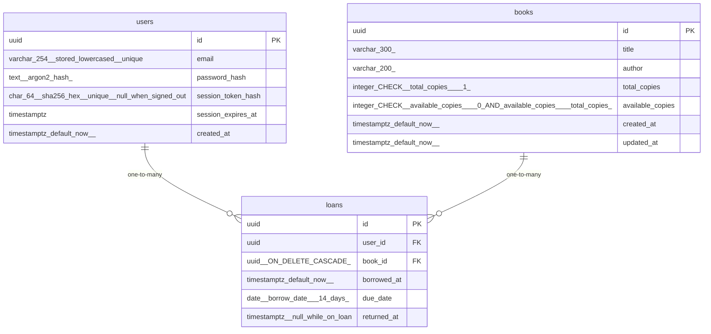

# Data Model

<!-- sdlc:auto:start entities -->
### users

| Field | Type | PK | FK | Nullable |
|---|---|---|---|---|
| id | uuid | True | — | False |
| email | varchar(254) stored lowercased, unique | False | — | False |
| password_hash | text (argon2 hash) | False | — | False |
| session_token_hash | char(64) sha256 hex, unique, null when signed out | False | — | True |
| session_expires_at | timestamptz | False | — | True |
| created_at | timestamptz default now() | False | — | False |

### books

| Field | Type | PK | FK | Nullable |
|---|---|---|---|---|
| id | uuid | True | — | False |
| title | varchar(300) | False | — | False |
| author | varchar(200) | False | — | False |
| total_copies | integer CHECK (total_copies >= 1) | False | — | False |
| available_copies | integer CHECK (available_copies >= 0 AND available_copies <= total_copies) | False | — | False |
| created_at | timestamptz default now() | False | — | False |
| updated_at | timestamptz default now() | False | — | False |

### loans

| Field | Type | PK | FK | Nullable |
|---|---|---|---|---|
| id | uuid | True | — | False |
| user_id | uuid | False | users.id | False |
| book_id | uuid (ON DELETE CASCADE) | False | books.id | False |
| borrowed_at | timestamptz default now() | False | — | False |
| due_date | date (borrow date + 14 days) | False | — | False |
| returned_at | timestamptz, null while on loan | False | — | True |
<!-- sdlc:auto:end entities -->

<!-- sdlc:auto:start relationships -->
| Source | Target | Type |
|---|---|---|
| users | loans | one-to-many |
| books | loans | one-to-many |
<!-- sdlc:auto:end relationships -->

<!-- sdlc:auto:start er-diagram -->

<!-- sdlc:auto:end er-diagram -->
