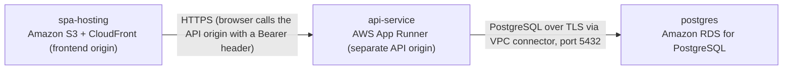

# Deployment Guide

> Maintained by QuorQ AI SDLC. Text between `sdlc:auto` markers is regenerated; anything outside them is yours and is kept.

<!-- sdlc:auto:start how-it-deploys -->
Pushes to `main` run `.github/workflows/deploy.yml`, which builds the API image (if there is a backend) and deploys the SPA to AWS Amplify. Commits touching only `docs/sdlc/**` don't deploy. Deployments can also be started from the platform's Deployment tab.
<!-- sdlc:auto:end how-it-deploys -->

<!-- sdlc:auto:start environments -->
| Name | Service | Runtime | Scaling | Environment |
|---|---|---|---|---|
| spa-hosting | Amazon S3 + CloudFront (frontend origin) | Static build of the React 19 app | Managed CDN, no scaling configuration | dev |
| api-service | AWS App Runner (separate API origin) | FastAPI 0.115 container served by uvicorn, image in Amazon ECR | 1 to 2 instances, small size, enough for hundreds of users | dev |
| postgres | Amazon RDS for PostgreSQL | PostgreSQL 16, small burstable single-AZ instance, encrypted storage, private subnet | Fixed small instance, no replicas | dev |
<!-- sdlc:auto:end environments -->

<!-- sdlc:auto:start live -->
**Frontend URL:** https://p18a1b5b19e80.d3j61xaup4zgrx.amplifyapp.com

**Backend URL:** https://34-216-165-23.sslip.io/apps/18a1b5b19e80/

**Database:** PostgreSQL · app

**Version:** c1efcddb53b1

**Commit:** `c1efcdd`

**Finished:** 2026-11-12
<!-- sdlc:auto:end live -->

<!-- sdlc:auto:start topology -->

<!-- sdlc:auto:end topology -->
